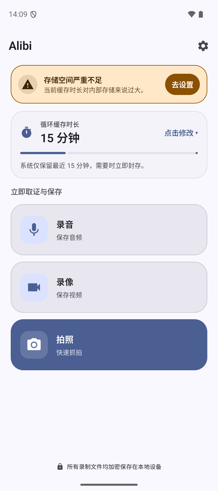
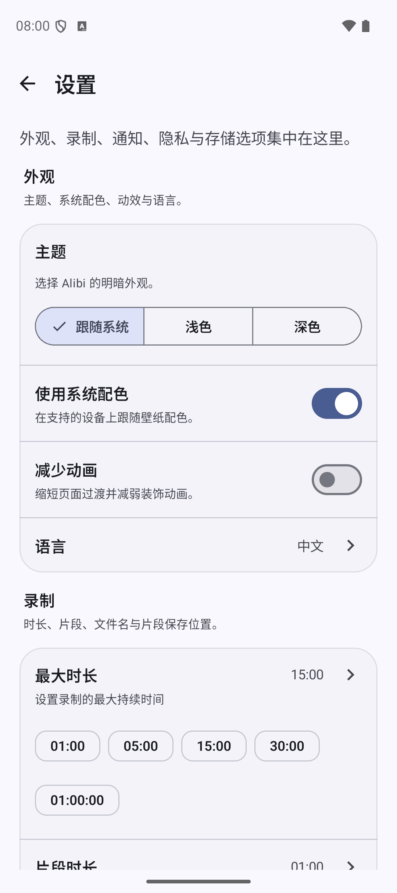
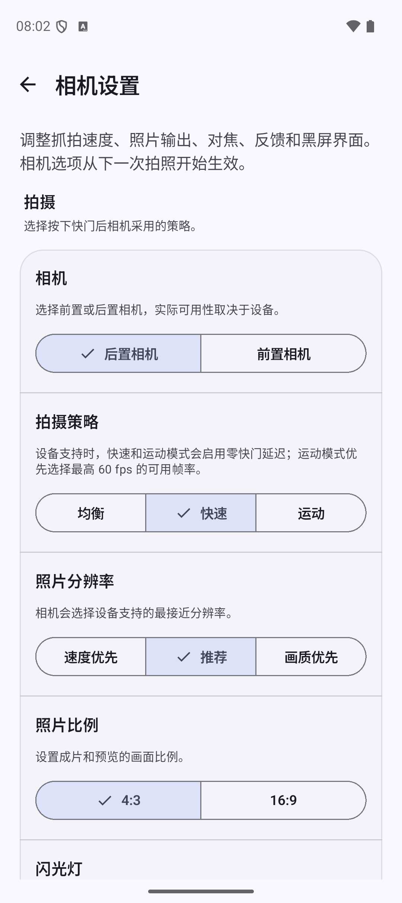
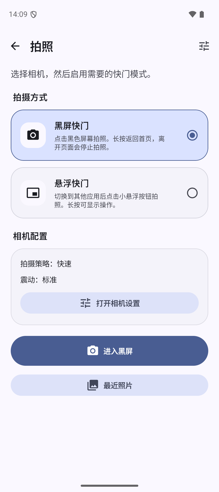

# Alibi

[](https://github.com/zgy-beep/Alibi/releases/latest)


Alibi is a local-first audio, video, and photo recorder for Android. It can keep
recording in the background and save the last configured time window at your
request. New photo capture modes work from a dark screen or a floating shutter
while another app is open.

The app has no internet permission. Recordings, photos, settings, and indexes
remain on the device.

## Current interface

| Home | Settings |
| --- | --- |
|  |  |

| Camera settings | Black screen shutter |
| --- | --- |
|  |  |

| Photo capture setup | Partial camera reveal |
| --- | --- |
|  |  |

## Features

### Background recording

- Continuous audio and video recording
- Configurable rolling duration and segment interval
- Save the last recording window on demand
- Background foreground-service notifications
- Custom save locations and filename formats

### Photo capture

- Black screen shutter with tap-to-capture
- Floating shutter over other apps
- Continuous tapping with a bounded capture queue
- Capture only after the camera is ready
- Successful-capture vibration with short feedback profiles
- Recent photos, open, share, and storage recovery
- Launcher shortcuts for immediate background audio recording and floating
  photo capture

### Camera controls

- Balanced, fast, and motion capture strategies
- Zero shutter lag, optical stabilization, and continuous autofocus when the
  device supports them
- Speed, recommended, and quality resolution preferences
- 4:3 and 16:9 frames
- Flash, rule-of-thirds grid, launch preview, zoom memory, and front-camera
  mirroring
- Floating shutter opacity

### Interface

- Material 3 Expressive direction with dynamic color and shared surface tokens
- System, light, and dark appearance
- Reduced-motion support
- Full-width vertical home actions on compact and wide screens
- Green running indicator in app title bars whenever recording or photo capture
  is active

## Download

Download the latest signed universal APK from
[GitHub Releases](https://github.com/zgy-beep/Alibi/releases/latest).

The package ID of this fork is:

```text
com.zgybeep.alibi
```

Debug builds use `com.zgybeep.alibi.debug`. The fork can be installed alongside
the upstream `app.myzel394.alibi` application and does not share its private app
data.

To install:

1. Download `app-universal-release.apk` from the latest GitHub Release.
2. Allow installation from the browser or file manager when Android asks.
3. Open Alibi and grant the permissions needed for the features you use.

Supported ABIs: `arm64-v8a`, `armeabi-v7a`, `x86`, and `x86_64`.

## Updates and compatibility

- Release APKs are signed with the dedicated Alibi Release certificate.
- Future releases must use the same signing certificate to update an installed
  fork build.
- Debug and release packages have different application IDs and can be
  installed independently.
- The fork does not replace or upgrade an upstream Alibi installation.
- Removing the app may delete app-private recordings. Export important files
  before uninstalling or clearing app data.

## Build from source

Requirements:

- JDK 17 or newer
- Android SDK 36
- Build Tools 36.1.0

Build the debug APK:

```powershell
.\gradlew.bat :app:assembleDebug
```

Build a release APK:

```powershell
.\gradlew.bat :app:assembleRelease
```

Release signing is configured through the ignored `key.properties` file. The
keystore and passwords must never be committed to this repository.

Run the JVM tests:

```powershell
.\gradlew.bat :app:testDebugUnitTest
```

## Privacy

Alibi does not declare the Android internet permission. Media and indexes are
stored locally at the locations you choose. Read the complete
[privacy policy](PRIVACY_POLICY.md).

## License and upstream

Alibi is licensed under the
[GNU General Public License v3.0](LICENSE). This repository is an independent
fork of [Myzel394/Alibi](https://github.com/Myzel394/Alibi).

Translations can be contributed through
[Crowdin](https://crowdin.com/project/alibi). Upstream development can be
supported through [GitHub Sponsors](https://github.com/sponsors/Myzel394).
