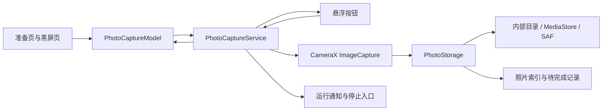
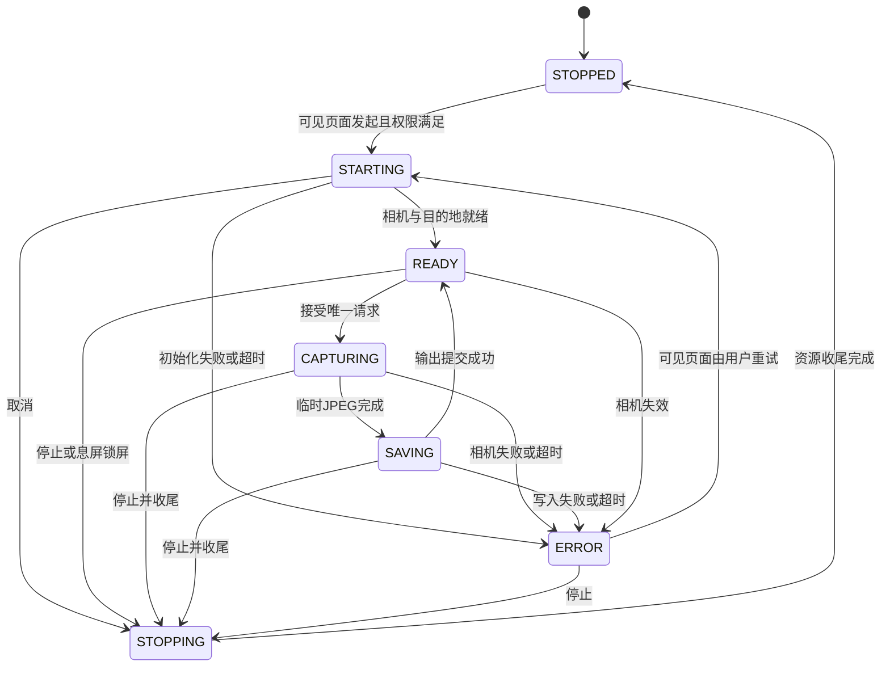

# Alibi 黑屏拍照与悬浮快门开发计划

- 文档日期：2026-10-24（Asia/Shanghai）
- 代码基线：`c7f4651`
- 当前状态：功能代码已实现；Kotlin 编译、单元测试、lint 和 Debug APK 打包通过；API 36 虚拟设备上的首页、权限、黑屏快门、快速连拍、长按退出和照片保存已完成验收。2026-10-27 完成变焦请求合并与悬浮窗变焦面板，自动化双指捏合/请求合并/悬浮变焦测试通过；物理真机矩阵仍待执行。
- 目标：应用内黑色页面点按拍照；应用退到后台后，通过悬浮按钮点按拍照。
- 实施前提：先完成 P0 技术验证，再按本文的功能约定实施。

## 0. 实施记录（2026-10-24）

- 已实现首页照片入口、前后镜头选择、黑屏点按页面、浮动快门、前台服务、前台停止通知、照片索引、最近照片预览和分享。
- 首页参考用户提供的 `C:\Users\Administrator\Downloads\首页.txt` 重构：顶部品牌、状态胶囊和设置按钮，紧凑存储提示，中央缓存时长仪表盘，以及录音、录像、拍照三张等尺寸横向模式卡片；录像作为主操作突出显示。
- 首页主内容可滚动，底部“所有录制文件均加密保存在本地设备”提示固定在导航安全区上方；缓存卡片高度、操作卡片位置和留白按参考图调整，避免操作入口过早结束并留下大片空白。
- 黑屏快门和悬浮快门使用请求队列：点击立即震动并入队，相机拍完一张后马上处理下一张，文件保存由后台串行完成。
- 相机会话额外绑定低分辨率图像分析流以维持测光和自动曝光，避免每次点击才重新启动取景链路；图库可用性检查移至 IO 线程。
- 黑屏拍摄过程中保持纯黑，仅使用震动反馈；长按黑屏直接停止会话并回到首页，页面切换使用 180–220ms 的淡入缩放动画。
- 黑屏页支持单指上下滑动连续调节相机预览透明度：向上滑动逐渐显示，向下滑动逐渐隐藏，松手后停在当前透明度；触摸越过系统触摸阈值后才接管手势，避免滑动被识别为拍照，并保留点击拍照、长按退出和双指缩放。[部分透明度截图](../evidence/preview-transparency-api36.png)
- 黑屏页支持双指缩放，通过 CameraX ZoomState 限制设备支持的最小和最大倍率，并在手势期间短暂显示倍率。
- 已实现 JPEG 临时文件提交、内部/MediaStore/SAF 保存、保存失败后不重新曝光的重试操作、运行中锁定保存目录，以及向旧设置应用默认值。
- 已修正照片会话停止期间的晚到回调处理，并限制现有视频预览只解绑自己的 CameraX 用例。
- 新增用户可见的“快速抓拍模式”，默认开启，可在拍照准备页和高级设置中切换；会话启动时检测设备能力，并逐项启用零快门延迟、至少 30fps 的曝光节奏和光学防抖，不支持的能力安全回退。[入口截图](../evidence/fast-capture-setup-api36.png)
- `:app:compileDebugKotlin`、`:app:testDebugUnitTest`、`:app:lintDebug`、`:app:assembleDebug` 通过；单元测试共 7 项通过。
- API 36 x86_64 虚拟手机（Android 16、前后虚拟摄像头、1080×2424、420 dpi）已验证：权限流程、黑屏拍摄、5 次快速连点生成 5 张可读 JPEG、悬浮快门点击、拖动不误拍、长按菜单、停止、图库缩略图、分享、打开和息屏停止；竖屏首页三张操作卡片尺寸一致，底部安全提示无截断，拍摄期间不显示状态文字，长按直接回首页。
- 快速抓拍开关已验证可持久化；虚拟后置相机报告 `ZSL=false`，正确回退到低延迟拍摄并应用 `[30, 30]` 帧率，虚拟前置相机报告 `ZSL=true` 并成功走零快门延迟路径；两类相机均不支持 OIS。开启和关闭快速模式的多个分支均能连续保存照片。
- 2026-10-27 照片画质完善时已将 CameraX 从 1.3.4 升级到 1.5.3。项目当前为 compileSdk 36、AGP 8.9.1、Kotlin 2.0.21，满足 1.5.3 要求（其 kotlin-stdlib 2.0.21 与项目一致）；1.5.3 同时修复了 API 36 模拟器上非 ZSL 拍摄打开会话失败的问题。最新稳定版 1.6.2 要求 kotlin-stdlib 2.1.20，需要单独升级 Kotlin/Compose 插件后再评估，不与本次画质改动混合。
- 验收截图：[首页](../evidence/home-api36.png)、[黑屏快门页](../evidence/black-screen-api36.png)。系统相机隐私指示属于 Android 平台行为。
- 双指缩放已通过 CameraX `cameraControl.setZoomRatio()` 接入，倍率受设备 `minZoomRatio/maxZoomRatio` 限制。2026-10-27 起变焦请求改为 latest-wins 合并（`ZoomRequestQueue`）：连续手势最多一个 CameraX 请求在途，模拟器上 60 次 60 Hz 输入合并为 7 次请求，最新请求滞后 183 ms，避免预览随请求堆积而滞后；见[验收报告](../reviews/zoom-overlay-2026-10-27.md)与[证据](../evidence/zoom-2026-10-27/README.md)。Compose instrumentation 已能在 API 36 模拟器上自动注入双指捏合验证倍率变化；物理手机的倍率范围、缩放方向和手感仍需真机确认（U05）。
- 悬浮快门长按面板已加入倍率调节：−/当前倍率/＋、对数映射滑杆、点击倍率重置；到设备边界禁用按钮，相机不支持变焦时显示提示并隐藏控件。`rememberZoom` 对悬浮模式生效；截图为深色桌面背景，大字体与读屏待真机复核。
- 2026-10-27 照片画质完善：默认“推荐”分辨率目标从 1920×1440 / 1920×1080 提升到 4000×3000 / 3840×2160（约 12MP / 8MP）；“画质优先”请求设备最大支持尺寸，并使用 JPEG 100、软件 JPEG 编码、设备支持时的高质量降噪/锐化、非 ZSL 的稳定拍摄路径，同时跳过额外分析流。CameraX 升级到 1.5.3 后，API 36 模拟器上画质路径可正常拍摄；视频录制冒烟通过。真机分辨率/色彩/噪声与系统相机计算摄影差距仍需物理设备验收。
- 2026-10-28 相机扩展（夜景/HDR）：新增「相机扩展」拍照设置，可选关闭（默认）/自动/夜景/HDR；启动会话时通过 CameraX `ExtensionsManager` 检测当前镜头能力，自动优先夜景、其次 HDR，不支持或初始化超时（3 秒）则回退标准管线；扩展生效时关闭 ZSL/固定帧率与闪光灯，跳过不支持的 ImageAnalysis，并在绑定失败时回退标准相机。华为 Mate 70 Pro（PLR-AL50，HarmonyOS 4.3 / Android 12）实测不提供夜景或 HDR 扩展，自动模式已回退标准拍摄并验证可正常拍照；其他支持扩展的机型待验证。
- 2026-10-28 高分辨率设备画质修复：真机实测发现软件 JPEG 会把画质模式限制在约 8MP；改为从 Camera2 JPEG 流配置读取硬件上限，仅当硬件 JPEG 上限 ≤8MP 时使用软件 JPEG，高像素设备使用硬件 JPEG 以保留最大分辨率（华为 Mate 70 Pro 输出 6144×8192 / 50MP，JPEG 100）。0.6.3 发布包不包含此修复。
- 尚未连接具备摄像头的物理手机；物理设备的快门延迟、厂商后台限制和 Android 7-15 兼容仍需继续执行 P0 与设备矩阵。

## 1. 计划审查结论

上一版计划的两种拍照入口、独立照片服务和共用拍照链路方向正确，可以继续。以下内容需要补齐后才能作为开发依据。

| 审查项 | 结论与修订 |
| --- | --- |
| 后台悬浮快门 | 可作为目标能力。必须先在可见 Activity 中启动相机前台服务，再由悬浮按钮向已运行服务发送拍照命令。悬浮窗授权不能替代相机使用期间权限。 |
| Android 15 限制 | “持有悬浮窗权限且窗口可见”属于特定后台启动前台服务条件，主要受 targetSdk 影响；不能据此推导任意后台相机冷启动可用。首版统一从可见页面启动。 |
| Android 7 兼容 | 项目 minSdk 为 24。API 26 及以上使用 `TYPE_APPLICATION_OVERLAY`；API 24–25 需要独立旧窗口类型适配与验证。 |
| 黑屏含义 | 黑屏指亮屏显示黑色内容，保持触摸可用。系统状态提示和手势导航可能显示；不能承诺物理熄屏、完全无系统提示。 |
| 无预览拍照 | 使用 CameraX `ImageCapture` 是合理方案，但“无可见预览、Service 生命周期、后台保存”组合需要真机验证，不能仅凭现有后台视频推定照片功能已可用。 |
| 代码复用范围 | 复用设置、权限展示和部分 UI。循环片段服务、FFmpeg 拼接及循环清理机制不适合单张照片。 |
| 相机资源竞争 | 现有预览与视频服务使用 `unbindAll()`，需要明确相机所有权和解绑顺序，防止切换页面时中断照片服务。 |
| 文件保存 | 必须定义成功时点、失败清理、SAF 授权失效和进程中断恢复，避免只收到相机回调就提示“保存成功”。 |
| 后台照片方向 | 没有前台页面时仍要更新照片方向；不能只读取 Activity 的显示方向。 |
| 通知与进程停止 | 通知授权拒绝不等于不能启动前台服务。系统停止应用也不保证调用清理回调，需要启动时恢复检查。 |
| 应用锁与持续运行 | 明确已授权悬浮会话、重新进入应用、息屏锁屏及认证失败的行为。 |

以上为代码与官方文档审查结论，不代表设备兼容性、性能或后台存活能力已验证。相关平台依据见第 12 节。

## 2. 首版范围与功能约定

### 2.1 首版交付内容

1. 首页新增“拍照”入口，进入拍照准备页，可选择前置或后置镜头。
2. 准备页提供“黑屏拍照”和“悬浮拍照”两个启动操作。
3. 两种入口共用一个拍照会话、一个相机服务和一套照片保存逻辑；照片内容来自用户选择的摄像头。
4. JPEG 单张拍摄；默认后置镜头、关闭闪光。每次点击被接收时立即短震，不等到照片保存完成才反馈；前置照片默认不做自拍镜像。
5. 沿用现有保存目录设置，支持应用内部目录、系统媒体目录、用户授权目录。
6. 提供最近照片列表、应用内预览、导出与分享；仅管理本功能生成的照片。
7. 通知显示拍照模式正在运行，提供“停止”操作；后台快门由悬浮按钮提供。
8. 首版与现有音频、视频录制模式互斥，沿用当前单一活动模式的首页结构。切换前提示用户先处理当前录制，不自动删除或停止已有录制。

支持最多 8 个待处理请求的连拍队列：相机按顺序连续曝光，文件在后台按顺序保存，队列满后忽略新请求。首版不包括定时拍照、录像中抓拍、多镜头同时拍摄、外接相机和锁屏触摸快门。

### 2.2 黑屏拍照交互

| 操作或事件 | 预期行为 |
| --- | --- |
| 点击“黑屏拍照” | 完成相机与目标目录检查，启动会话；就绪后进入黑色页面，进入页面本身不触发拍摄。 |
| 首次进入 | 最多显示约 2.5 秒“点击拍照，长按返回首页”的一次性提示，随后隐藏。默认不显示实时相机预览。 |
| 黑色页面单击 | 会话处于可拍、拍摄中或保存中时接受请求；点击后立即短震并入队。每个被接受的请求最多生成一张照片。 |
| 连续点击 | 最多接受 8 个待处理请求；相机拍完一张立即处理队首，文件由后台串行保存。队列满时忽略新点击，避免无限积压。拍摄后不显示文字状态。 |
| 长按 | 直接停止当前拍照会话并返回首页，不显示操作面板；长按和抬手不额外拍照。 |
| 系统返回 | 停止当前拍照会话并返回首页；已保存照片保留。 |
| Home、切换应用 | 黑屏模式下停止会话；如需后台拍照，先在操作面板切换到悬浮模式。 |
| 旋转与配置重建 | 保持同一会话，不自动拍照、不重复创建服务；画面保持黑色。 |
| 相机或保存错误 | 显示可理解的错误和“返回／重试／停止”，不继续维持无反馈的全黑界面。 |

黑屏页面使用黑色背景和系统支持的沉浸显示，并仅在该页面可见时设置保持亮屏。亮度调整作为可选设置，离开时恢复原窗口值；首版默认沿用用户亮度。保存成功反馈默认开启，可在设置中关闭。系统相机使用指示与系统控制的快门声音遵循设备行为。

### 2.3 悬浮拍照交互

| 操作或事件 | 预期行为 |
| --- | --- |
| 点击“悬浮拍照” | 在可见页面完成相机和悬浮窗授权，启动前台服务并等待就绪，再显示可用状态；不主动强制切到桌面。 |
| 切到其他应用 | 显示约 56dp 的可拖动悬浮按钮；按钮之外的区域可正常操作其他应用。 |
| 点击悬浮按钮 | 向现有服务提交拍照请求，不打开拍照 Activity；拍摄中显示忙碌状态，成功短暂显示完成状态并反馈。 |
| 拖动悬浮按钮 | 达到系统触摸移动阈值后识别为拖动，抬手不触发拍照；位置限制在可见屏幕范围。 |
| 长按悬浮按钮 | 展开紧凑操作面板，提供变焦调节（−/倍率/＋、滑杆、重置）、“返回应用”“停止”和“收起”；展开与收起均不触发快门。 |
| 调整倍率 | 面板变焦控件在设备 `minZoomRatio/maxZoomRatio` 内调整相机缩放；−/＋按步进、滑杆直接定位、点击倍率重置到最小；到边界禁用对应按钮；变焦不丢弃已受理的照片请求。 |
| 返回应用 | 应用解锁后显示会话控制页；前台页面可见时隐藏悬浮按钮，避免两个触摸入口重叠。 |
| 再次切到后台 | 仍为悬浮模式且会话有效时，恢复悬浮按钮，不重新启动相机。 |
| 切换到黑屏 | 使用现有会话，隐藏悬浮按钮；切换过程不拍照、不重建相机服务。 |
| 点击“停止” | 关闭整个照片会话，移除按钮并释放相机；不是只隐藏按钮继续占用相机。 |
| 其他应用禁止悬浮窗或系统临时隐藏窗口 | 接受系统行为，不尝试覆盖系统安全界面；回到允许显示的页面后按实际窗口状态恢复。 |

悬浮按钮至少区分“初始化、可拍、忙碌、错误”四种状态，并提供可访问性描述。尺寸、边缘停靠与最后位置由设置保存；初始位置位于右侧中部并避开系统栏。窗口不申请键盘输入焦点，不使用覆盖整屏的透明可触摸窗口。

### 2.4 生命周期与退出约定

- 用户息屏或设备进入锁屏时，首版停止照片会话；解锁后由用户在应用内重新启动。已受理的拍摄进入有期限的收尾，不受理新快门。
- 悬浮模式下普通 Home 操作保持会话；从最近任务划掉页面时，标准系统允许时继续运行，但不承诺绕过厂商后台清理。
- 服务采用 `START_NOT_STICKY`。进程被杀、系统“活动应用”停止、强行停止、重启设备后，不自动恢复相机或悬浮窗。
- 正常停止走幂等清理流程；进程被直接终止时，依赖系统回收窗口与相机资源，并在下次启动核对未完成保存记录。不能依赖 `onDestroy()` 必然发生。
- 正常停止先主动解除照片用例、窗口和通知，再调用 `stopSelf()`。Activity 尚持有绑定时服务对象可能仍存在，不能等待其销毁才释放相机；UI 随后解除绑定。
- 黑屏页面的后台判定区分配置重建、权限流程与真实离开；通过 Activity／进程可见状态及会话阶段判断，避免简单地在每次 `onPause()` 就误停止。
- 应用锁启用时，开始新会话和查看照片必须经过现有认证。已认证启动的悬浮会话在设备未锁定期间继续工作；返回应用仍遵守应用锁。
- 现有认证失败路径会调用 `exitProcess(0)`，应在可正常执行的退出路径先停止照片会话；强制终止兜底依靠下次启动恢复。不能把“认证失败”当作新会话的启动入口。

## 3. Android 平台与权限方案

### 3.1 权限与启动顺序

1. 在 Activity 可见且必要时应用锁已通过的状态下，展示所选模式说明。
2. 请求 `CAMERA`。照片功能不要求 `RECORD_AUDIO`。
3. 检查保存目的地。只有 API 24–28 保存到公共媒体目录时按需请求旧存储权限；内部目录和已授权 SAF 目录按各自规则处理。
4. 仅悬浮模式请求 `SYSTEM_ALERT_WINDOW` 特殊访问权限，通过系统设置页授权；返回后用 `Settings.canDrawOverlays()` 重新读取实际结果。
5. API 33 及以上按需请求通知权限。拒绝时仍可启动照片功能，界面说明通知栏停止入口可能不可见，保留悬浮与应用内停止入口。
6. 用户返回权限设置后，仅在 Activity 再次处于可见状态、授权满足且原启动意图仍有效时继续。取消、返回或重复生命周期回调不重复启动。
7. 在该可见页面调用版本兼容的前台服务启动方法。服务进入启动回调后立即建立前台通知，再异步初始化相机；不等待 binder 连接或相机就绪才调用 `startForeground()`。
8. 相机就绪后启用黑屏快门或悬浮按钮；任意一步失败均释放本次创建的资源。

Android 14 的相机使用期间权限检查与一般后台服务启动限制是两套约束。首版不依赖悬浮窗可见来绕过相机冷启动限制。[依据：后台启动限制](https://developer.android.com/develop/background-work/services/fgs/restrictions-bg-start)。

Android 13 及以上即使用户拒绝通知权限，服务仍须按规定提交前台通知；通知是否出现在通知栏由系统决定。[依据：通知权限](https://developer.android.com/develop/ui/compose/notifications/notification-permission)。

### 3.2 分版本兼容

| 版本范围 | 实现与验收重点 |
| --- | --- |
| API 24–25 / Android 7 | 验证 `TYPE_PHONE` 等该范围支持的窗口类型、悬浮授权、相机服务和公共目录权限；只在此版本分支使用旧窗口类型。 |
| API 26–28 / Android 8–9 | `TYPE_APPLICATION_OVERLAY`；前台通知渠道；前台服务启动时限；旧公共存储路径与媒体扫描。 |
| API 29–30 / Android 10–11 | 图片通过 `MediaStore.Images` 保存，使用分区存储；API 30 的 camera 前台服务类型；后台切换与相机访问。 |
| API 31–32 / Android 12 | 后台启动限制、相机隐私开关、悬浮触摸遮挡规则、系统及敏感页面隐藏悬浮窗的行为。 |
| API 33 / Android 13 | 通知授权允许与拒绝、系统活动应用停止入口。 |
| API 34 / Android 14 | 相机前台服务专用权限与使用期间检查；可见页面启动、取消启动和后台误启动异常。 |
| API 35–36 / Android 15–16 测试设备 | 验证现有 targetSdk 34 的实际行为；后续提高 targetSdk 时重新执行相关兼容用例。Android 15 的悬浮窗后台服务启动收紧条件按目标版本区分。 |

项目当前 `compileSdk = 36`、`targetSdk = 34`、`minSdk = 24`，CameraX 为 1.5.3。本功能使用项目已有依赖可用的 API；如发现确定的库缺陷，再单独评估升级并回归视频录制。发布需要的 targetSdk 升级须明确记录，不能把 target 34 的测试结果直接作为升级后的结果。

悬浮窗类型从 API 26 才提供新类型；窗口可能被系统调整或被其他页面隐藏，因此“所有页面永久可见”不作为验收承诺。[窗口类型依据](https://developer.android.com/reference/android/view/WindowManager.LayoutParams)、[隐藏悬浮窗依据](https://developer.android.com/about/versions/12/features#hide-application-overlay-windows)。

## 4. 代码现状与改动范围

下表以 `app/` 开头的路径相对仓库根目录；其他 Kotlin 文件路径相对 `app/src/main/java/app/myzel394/alibi/`。新增文件名为实施建议，开发时可根据实际组织微调职责。

| 当前文件或模块 | 已核对事实 | 实施要求 |
| --- | --- | --- |
| `app/build.gradle` | minSdk 24、targetSdk 34 / compileSdk 36，已有 CameraX 1.5.3 和 LifecycleService 依赖 | 检查所用 API 版本；必要依赖调整有单独理由。 |
| `app/src/main/AndroidManifest.xml` | 已声明 CAMERA、FOREGROUND_SERVICE_CAMERA 和前台服务权限；没有悬浮窗权限、照片服务或 FileProvider | 新增悬浮窗权限、照片专用 camera 服务；若采用后台震动则补充 VIBRATE；分享内部照片时增加范围受限的 FileProvider。服务 `exported=false`。 |
| `ui/screens/RecorderScreen.kt`、`ui/components/RecorderScreen/organisms/StartRecording.kt` | 当前入口和活动状态只处理音频、视频 | 增加照片入口、活动会话展示与模式互斥，不让已运行照片服务被当作空闲。 |
| `ui/Navigation.kt`、`ui/enums/Screen.kt` | 当前路由无照片页面 | 新增准备、黑屏、最近照片路由；在导航根部绑定照片服务并正确解绑。 |
| `ui/models/BaseRecorderModel.kt` | 泛型约束依赖 IntervalRecorderService 和 BatchesFolder | 新增独立 PhotoCaptureModel，不强行扩展循环片段抽象。 |
| `services/VideoRecorderService.kt`、`ui/components/RecorderScreen/atoms/CameraPreview.kt` | 使用进程级 ProcessCameraProvider，存在 `unbindAll()` | 新增用例只解绑自身；约束旧视频与预览用例的所有权、释放和生命周期，避免晚到的预览协程误绑相机。 |
| `ui/utils/camera-info.kt` | 当前实现把字符串设备 ID 转 Int，并以其推断 lens；传入的 lensFacing 未使用 | 照片首版用 CameraX 的前后置选择与可用性判断；不照搬相机 ID 等于镜头朝向的假设。 |
| `db/AppSettings.kt`、`db/AppSettingsSerializer.kt` | JSON 序列化设置，包含 saveFolder、filenameFormat 等录制配置 | 新增带默认值的照片设置；明确照片文件命名规则；验证旧设置、导入导出和未知字段策略。照片索引不写入 lastRecording。 |
| `ui/screens/SettingsScreen.kt`、`ui/components/SettingsScreen/Tiles/SaveFolderTile.kt`、`ui/components/SettingsScreen/Tiles/ImportExport.kt` | 设置修改可能影响正在运行的模式；目录选择会释放其他已持久化 URI 授权 | 照片会话期间锁定目的地并拦截改变目的地的设置导入；授权清理需保留照片历史仍引用的目录授权。 |
| `NotificationHelper.kt`、`services/RecorderNotificationHelper.kt` | 现有录制通知使用固定 ID，文案区分音频和视频 | 照片使用独立通知 ID 和明确文案，不误取消其他通知；显式不可变 PendingIntent 指向停止命令。 |
| `ui/AsLockedApp.kt`、`helpers/AppLockHelper.kt` | 应用锁包裹导航，认证失败可直接退出进程 | 新入口继续遵守认证；退出路径与照片会话收尾协调。 |
| `helpers/VideoBatchesFolder.kt`、`services/IntervalRecorderService.kt`、`ui/components/RecorderScreen/organisms/RecorderEventsHandler.kt` | 录制保存及事件处理依赖片段循环、拼接及清理 | 照片保存及事件处理独立实现，不接入循环删除和最后录制恢复。 |

建议新增职责：

| 新模块 | 职责 |
| --- | --- |
| `services/PhotoCaptureService.kt` | 会话事实来源、前台通知、相机生命周期、拍照命令、停止与恢复状态。 |
| `services/PhotoOverlayController.kt` | WindowManager 添加／更新／移除窗口、拖动／点击判定、显示状态；由照片服务持有。 |
| `ui/models/PhotoCaptureModel.kt` | 服务连接、状态订阅、UI 命令；不持有后台相机或 Activity 的长期引用。 |
| `ui/screens/PhotoSetupScreen.kt`、`BlackPhotoScreen.kt`、`RecentPhotosScreen.kt` | 准备、黑屏触摸、会话操作与照片管理。 |
| `helpers/PhotoStorage.kt`、`PhotoRepository.kt` | 临时 JPEG、输出提交／回滚、历史索引、未完成写入恢复。 |
| `db/PhotoCaptureSettings.kt` | 镜头朝向、反馈开关、悬浮位置等用户偏好。 |

## 5. 架构与会话状态



会话模式与拍摄状态分开表达：模式为 `BLACK_SCREEN` 或 `FLOATING`，状态为 `STARTING / READY / CAPTURING / SAVING / STOPPING / ERROR / STOPPED`。前台界面重建不改变会话事实。



状态处理要求：

- service 启动即读入不可变会话配置；镜头与保存目的地更改在下一次会话生效。
- 绑定用例成功不等于相机已可拍；观察 CameraState 和实际启动结果，只在满足条件后暴露 READY。相机占用或断开进入不可拍状态；有限恢复期间持续显示“恢复中”，不能仍显示可拍。[CameraState 依据](https://developer.android.com/reference/androidx/camera/core/CameraState)。
- 单一串行命令入口控制拍摄，用会话 ID、请求 ID 和原子状态转换防重；触摸、悬浮窗和生命周期回调不能分别启动拍摄任务。
- STARTING、STOPPING 不接受新快门；READY、CAPTURING、SAVING 接受新请求并进入有界 FIFO，当前曝光之外最多排队 8 张。点击接收时立即反馈，超出上限的请求忽略。
- 模式切换仅在 READY 完成；忙碌时提示等待，避免切换或抬手误触。切换不重新打开相机。
- 用例绑定／解绑与窗口操作在主线程；JPEG 文件处理和目录写入在 IO 执行；服务作用域管理协程，不使用全局任务。
- UI 通过可观察状态接收结果；Activity 销毁不能清空服务持有的真实会话。后台错误通过按钮和可用的通知表达，前台显示具体原因。
- PhotoCaptureService 继承 LifecycleService，按要求调用父类生命周期方法；相机用例绑定服务生命周期。重连只绑定已经启动的服务，不因打开导航或读取状态自动创建后台相机会话。
- 初始看门狗预算：启动 15 秒、单次拍摄加保存 30 秒、主动停止收尾 5 秒。P0 记录实际数据后可调整常量；超时必须结束忙碌态，不得永远等待。
- 停止后旧回调按会话 ID 判定，只执行必要文件收尾，不重新创建按钮、通知或 READY 状态；文件流的关闭须与生产者完成／终止协调。

相机在会话 READY 时保持可用，优先保证点击响应。持续开启会消耗电量，需要记录功耗和温升；首版通过明确停止入口和息屏停止控制持续运行，不在每次悬浮点击时后台重启服务。

## 6. 图片方向、输出与照片管理

### 6.1 拍摄配置

- 首版 JPEG，使用当前 CameraX 版本支持的分辨率选择方式，采用受设备能力支持的常规分辨率；不承诺所有设备固定输出同一尺寸。
- 默认无闪光、无前置屏幕闪光，保留自动曝光、白平衡和自动对焦能力。
- 服务在会话期间管理方向监听，结合设备自然方向设置 `targetRotation`；在每次受理快门时固定本次方向，覆盖 0、90、180、270 度及关闭系统自动旋转的情况。传感器无法确定方向时使用上一个有效值。
- 前置照片的旋转与镜像分别处理；验收以照片查看结果和 EXIF 为准。[旋转依据](https://developer.android.com/media/camera/camerax/orientation-rotation)。

### 6.2 保存目的地

沿用 `AppSettings.saveFolder`，启动时解析为会话目的地；同时兼容现有 `null` 和内部目录标记。照片单独存放，不能混入 `.audio_recordings`、`.video_recordings` 循环片段目录。

| 目的地 | 首版处理 |
| --- | --- |
| 应用内部目录 | 最终文件存入 `filesDir/photos/`；不使用 cacheDir 作为已保存照片位置。 |
| 系统媒体目录，API 29+ | 使用 `MediaStore.Images`，位置为 `DCIM/alibi/photos`，与现有“媒体目录／DCIM”设置语义一致；写入期间 pending，完成才对外公布。 |
| 系统媒体目录，API 24–28 | 取得需要的旧存储授权后写入公共 DCIM 子目录，写完触发媒体扫描。 |
| 自定义 SAF 目录 | 检查树 URI 持久授权和 provider 写入能力，创建 image/jpeg 文档并通过 OutputStream 写入；目录删除或授权撤销时停止接受新快门并提示重选。 |

CameraX 输出支持 File、MediaStore 和 OutputStream；首版为统一失败恢复，先拍成应用内部临时 JPEG，再提交目标位置。[输出接口依据](https://developer.android.com/reference/kotlin/androidx/camera/core/ImageCapture.OutputFileOptions.Builder)。媒体目录保存与公共可见性按 [MediaStore 文档](https://developer.android.com/training/data-storage/shared/media)实现。

照片命名使用 `alibi-photo_yyyyMMdd_HHmmss_SSS_<短随机标识>.jpg`，避免同毫秒覆盖。现有录像的“片段开始时间”命名选项不直接套用照片；设置文案说明照片按拍摄时间命名。

### 6.3 成功、失败与中断恢复

1. 生成请求 ID 与 `filesDir/photo_pending/` 临时路径，在独立的待完成记录中标记请求。待完成记录采用可恢复的原子写入；暂存使用持久应用文件目录，便于进程重启后恢复。
2. CameraX 将单张照片写入内部临时文件，不把整张照片长期保留在内存。
3. 在 IO 线程检查文件有效性，准备目的地；外部 URI 分配结果及时写入待完成记录。
4. 内部目录通过同文件系统的临时文件提交；MediaStore 使用 pending；SAF 通过流复制并完整关闭。
5. 目标写入完成后记录“照片已保存”、更新可恢复历史索引，再发出成功反馈。索引失败须保留可恢复记录；不能因此删除已经成功保存的照片或重新拍摄一张。
6. 失败时不发成功震动，尽力删除本请求创建的半成品，并保留可恢复的临时 JPEG供用户重试保存或导出。重试保存不再次曝光。
7. 正常停止后清理已确认无用的临时文件；异常重启只核对本功能记录且归属明确的文件／URI，不扫描删除用户其他文件。

SAF provider 不一定支持原子重命名或可靠删除，进程终止时也存在 provider 创建文档与本地记录之间的短窗口。因此不承诺所有外部目录永远没有半成品；要求不把半成品列为成功照片，能够提示并尽力恢复或清理。[SAF 持久授权及失效依据](https://developer.android.com/training/data-storage/shared/documents-files)。

照片不受循环录制的最大时长、片段清理和 deleteRecordingsImmediately 控制；停止会话不删除已保存照片。卸载时内部文件遵循 Android 应用数据清理行为，系统媒体和外部目录遵循各自存储规则。

### 6.4 最近照片与设置兼容

- 独立照片仓库保存 ID、输出 URI／私有路径、时间、镜头、尺寸和完成状态；小规模索引可用 AtomicFile JSON 实现，单一写入者管理，不为每张照片重写整个 AppSettings。
- 最近列表默认展示 50 条，缩略图按需加载；列表条数限制不删除文件。内部照片另提供按日期分页浏览与导出入口，避免较早照片因列表限制而不可访问。
- 对已被外部删除或失去授权的照片显示“不可访问”，不崩溃。调整现有目录授权清理时，保留当前目的地、活动会话和仍需访问的照片记录引用的树授权；实际重新授权由用户在前台完成。
- 内部照片分享通过 `content://` FileProvider 和临时读授权；路径配置只开放照片子目录，不开放整个 filesDir。导出可复用现有 CreateDocument 工作流，但成功提示必须依据复制结果。
- 新增设置字段均有默认值。验证旧版本 JSON、导入导出往返、未知字段与损坏数据处理，避免新增字段导致用户整份设置被重置。
- 会话运行时拦截保存目录变更及会改变目录的设置导入，提示先停止；不通过直接修改共享设置撤销当前会话所依赖的授权。

## 7. 异常行为与处理策略

| 场景 | 预期处理 |
| --- | --- |
| 未授权相机 | 在前台解释并请求；拒绝后保持准备页，不创建服务和按钮。 |
| 未授权悬浮窗 | 保留黑屏拍照入口；悬浮启动不进入运行态。 |
| 悬浮授权被撤销 | 处理 WindowManager／权限异常，移除窗口并停止悬浮会话；回应用后提示重新授权。 |
| 通知权限拒绝 | 服务按规定提交通知；保持可用的应用内／悬浮停止入口。 |
| 相机隐私开关关闭、其他相机应用抢占 | 状态转不可拍，忙碌请求失败有反馈；有限恢复无效后停止本会话，回前台由用户重试。 |
| 设备没有所选镜头 | 启动前禁用该选项或提示切换；不以字符串 ID 强转整数推断镜头。 |
| 快速重复点击或同时抬手 | 点击立即反馈并进入有界 FIFO 队列；队列上限 8，满载请求忽略。拖动、长按不额外触发。 |
| 目录不可写、授权失效、空间不足 | 不计为成功；尽力保留临时 JPEG 并提供重选目录或导出。 |
| 外部文件被删除 | 最近列表显示不可访问，可移除失效记录，不删除其他照片。 |
| 拍摄中停止、锁屏、退出 | 禁止新请求，在收尾时限内处理当前请求；随后解绑相机、关流、移除窗口、停止通知。 |
| 划掉任务或厂商清理 | 能继续时保持悬浮会话；被终止后不假装仍在运行、不自动重启相机；启动时恢复文件状态。 |
| 系统停止／强制停止／崩溃 | 允许没有清理回调；窗口和设备资源由系统回收，待完成文件下次启动核对。[系统停止依据](https://developer.android.com/develop/background-work/services/fgs/handle-user-stopping)。 |
| UI 重建、横竖屏或多窗口变化 | 保持唯一服务与会话；悬浮位置重新约束到可见区域，不产生重复照片。 |
| 旧预览初始化协程晚到 | 页面退出后取消／失效化旧绑定任务；仅当前相机所有者可绑定，不允许误解绑照片用例。 |

## 8. 实施阶段、依赖与交付物

| 阶段 | 工作与交付物 | 进入下一阶段的条件 |
| --- | --- | --- |
| P0 技术验证 | 以当前依赖实现最小 Service + ImageCapture，无可见预览拍一张；前后台切换；真实悬浮按钮拍照；验证 API 24–25 窗口分支和 API 34+ 启动；记录首张图、方向、延迟、相机错误与环境。 | 至少现代 Android 真机证实核心链路；旧版本窗口分支有验证结果。失败须明确原因和降级范围，不能宣称全部支持。 |
| P1 会话与存储 | 服务前台化、状态机、命令去重、照片落盘、三种目录、pending 恢复、相机所有权约束与自动化测试。 | 准备页能够可靠启动、拍摄、停止；目录和中断失败可恢复，现有录制不被误解绑。 |
| P2 黑屏 UI | 准备页与路由、黑色触摸页面、反馈、退出、亮屏与亮度恢复、应用锁接入。 | 黑屏交互及后台切换规则通过验收，窗口设置能恢复。 |
| P3 悬浮 UI | 特殊权限流程、旧新窗口分支、拖动／点击／长按、状态反馈、前后台显隐和停止。 | 切到其他应用后点击可生成有效照片，拖动不误拍，权限撤销和停止无残留。 |
| P4 管理与整合 | 最近照片／内部照片访问、预览、导出分享、设置迁移、目录授权引用处理、文案与说明更新。 | 已保存照片可访问，导入导出和旧配置兼容，权限范围正确。 |
| P5 验收与修复 | 执行第 9 节矩阵和回归；产出 APK、测试结果、失败设备清单、已知限制与修复记录。 | 核心与异常必测项通过；剩余限制明确记录，完成标准见第 10 节。 |

实施顺序为 P0 → P1 → P2 → P3 → P4 → P5。P0 的临时代码纳入正式模块或清理后再交付，不保留多个相机初始化实现。

初步开发预算为 7–10 个工作日：P0 1 日、P1 2 日、P2 1 日、P3 1–2 日、P4 1–2 日、P5 1–2 日。预算假设有 Android SDK、可用真机和可构建的现有依赖；厂商兼容问题与发布要求的 SDK 升级单独评估。该预算是排期估计，不是已验证的性能或工时保证。

## 9. 可执行验收清单

每项记录设备、系统 API、targetSdk、保存目录、操作步骤、预期／实际、证据和结果。未执行标为“未执行”；预期不支持的系统页面标为“受平台限制”，不能直接记为通过。

### 9.1 核心功能

| 编号 | 操作 | 通过标准 |
| --- | --- | --- |
| F01 | 后置黑屏模式启动后，等待每次保存完成再点击 20 次 | 恰好得到 20 张可解码 JPEG，文件名互不覆盖；进入页面和退出不额外拍照。 |
| F02 | 在受控慢保存情况下快速点击 20 次 | 每次被接收的点击立即震动；当前曝光之外最多排队 8 张，超出队列的点击被忽略；请求 ID 与最终成功文件一一对应。 |
| F03 | 黑屏长按、系统返回 | 长按与返回都不产生额外照片；直接回到首页，服务、相机和保持亮屏设置均退出。 |
| F04 | 进入悬浮模式后切到浏览器等普通应用，每次等待保存完成再点击，共 20 次 | 当前应用不被拍照 Activity 打断；正常条件下获得 20 张有效照片，每次有成功反馈。失败场景另按 E 类用例执行。 |
| F05 | 拖动按钮 20 次，长按菜单 10 次，操作按钮外区域 | 没有照片因拖动或长按产生；其他应用按钮与键盘操作正常，悬浮窗不抢输入焦点。 |
| F06 | 黑屏与悬浮模式切换、返回应用、再次 Home 共 10 轮 | 同一有效会话最多一个悬浮窗口，由服务独占管理一组照片用例；切换本身不拍照，服务不重复创建。 |
| F07 | 前后置各在四个方向拍照，并关闭系统自动旋转后重测 | 图像方向正确；前置符合默认非镜像约定；EXIF 与显示一致。 |
| F08 | 三类保存目录分别拍照、结束会话、重启应用、预览导出分享 | 文件完整，媒体目录可发现，内部照片可访问；分享仅授予目标文件临时读取权限。 |
| F09 | 连续拍摄超过 50 张并访问较早内部照片 | 最近列表限制不删除文件；早期内部照片仍可浏览与导出。 |

### 9.2 首页视觉与交互

| 编号 | 操作 | 通过标准 |
| --- | --- | --- |
| U01 | 在 API 36、约 411dp 宽竖屏设备及 360/430dp 宽度下检查首页 | 顶部品牌、状态胶囊和设置按钮不拥挤；存储提示、仪表盘和三张操作卡不截断；底部本地保存提示固定在导航安全区上方。 |
| U02 | 对比提供的参考首页 | 录音、录像、拍照为等尺寸横向卡片，录像使用主色突出；缓存仪表盘使用圆环，操作区位于拇指容易触及的区域。 |
| U03 | 点击缓存时长、存储提示和三个模式入口 | 每个点击区域语义清晰，分别进入时长选择、设置、录音/录像准备或拍照准备页，不出现无响应区域。 |
| U04 | 进入黑屏拍照并快速点击 5 次 | 每次点击立即有震动反馈，不显示“拍摄中/已保存”等文字，结果为 5 张可读 JPEG；长按直接回首页。 |
| U05 | 在物理手机上双指缩放与悬浮面板变焦 | 缩放方向符合常见相机习惯，倍率限制在设备支持范围，短暂倍率提示不遮挡快门区域；悬浮面板 −/＋/滑杆/重置与实际画面一致，边界按钮禁用，持续手势不造成明显请求积压。 |
| U06 | 开启／关闭快速抓拍并重启应用，再开始拍照 | 开关状态持久化；支持时使用 ZSL、至少 30fps 和 OIS，不支持时逐项降级；两种模式均能正常保存照片。 |
| U07 | 在黑屏页短距离上滑、继续上滑、短距离下滑，再点击和长按 | 预览透明度随单指纵向移动连续变化，松手后保持当前透明度；滑动不产生照片，点击拍照和长按退出仍正常。 |

### 9.3 权限、异常与生命周期

| 编号 | 操作 | 通过标准 |
| --- | --- | --- |
| E01 | 相机拒绝、永久拒绝、悬浮设置返回未授权、通知拒绝分别测试 | 遵守第 3 节启动顺序，无重复授权循环、崩溃或假运行按钮；通知拒绝场景仍符合设计。 |
| E02 | 黑屏正常运行时 Home，再在悬浮模式运行时 Home | 黑屏会话停止；悬浮会话按设计继续，两者行为明确。 |
| E03 | 两种模式分别息屏／锁屏，随后解锁 | 相机会话停止，不自动恢复拍照；必要时要求重新认证，已保存文件保留。 |
| E04 | 会话中打开系统相机／视频通话，或关闭相机隐私开关 | 不显示虚假可拍态；不会无限忙碌或自动连续拍摄；可停止并在前台恢复。 |
| E05 | 系统撤销悬浮授权；打开主动隐藏悬浮窗的测试页面 | 授权撤销可安全停止；系统隐藏不被绕过，返回普通页面按实际状态处理。 |
| E06 | 删除自定义目录、撤销 SAF 授权、模拟写入失败或空间不足 | 不反馈成功；没有成功索引指向半成品；可恢复的临时照片可重试保存。 |
| E07 | 在 STARTING、CAPTURING、SAVING 各阶段点击停止 | 5 秒收尾预算内结束运行或明确故障终止；晚到回调不复活窗口／相机。 |
| E08 | 在拍摄、外部复制、索引提交阶段终止进程后重开 | 不自动启动相机；恢复记录不会删除完整照片，不把半成品计为成功；可能的 SAF 残留有记录。 |
| E09 | 旋转、多窗口、配置重建、重复进入准备页／权限页 | 无重复服务、泄漏窗口、旧预览误解绑和重复快门。 |
| E10 | 运行时尝试更改保存目录、导入改变目录的设置 | 要求先停止；不撤销当前会话仍在使用的授权。 |
| E11 | 启用应用锁后启动悬浮会话、返回应用、认证失败退出 | 首次启动须认证，照片访问受锁保护；退出无后台照片会话残留。 |
| E12 | 使用系统活动应用“停止”、强行停止、移除最近任务 | 区分三类行为记录实际结果；被终止后按钮消失且无自动重启，重开无假运行态。 |

### 9.4 性能与回归

- 在确定的基准真机、良好光照、默认分辨率、内部目录下预热后测量 30 次。记录点击至请求受理、JPEG 完成、最终保存完成的 P50/P95；初始目标为点击至成功 P95 ≤ 2 秒，P0 若不满足须记录瓶颈并修订目标。该目标不适用于所有 SAF provider 和设备。
- 连续运行 30 分钟并每分钟拍一张，检查窗口数、相机所有权、文件描述符、内存变化、耗电和温升；无崩溃、ANR、持续资源增长或无限等待。未设置电耗硬阈值前，以实测报告作为交付证据，不标称零耗电。
- 回归音频和视频的开始、暂停／恢复、保存、退出及重新进入；回归视频预览、旧配置恢复、保存目录选择、应用锁和设置导入导出。
- 单元测试聚焦请求去重与状态机、模式互斥、停止时旧回调、命名冲突、目的地解析、JSON 兼容和保存恢复。文件系统可控测试覆盖写入／索引失败，不编写只复述 getter 的测试。
- 使用仪器测试验证服务连接／重建、黑屏手势和存储；悬浮特殊权限、跨应用窗口、厂商后台行为、照片方向和质量以真机为准，模拟器不能替代相机体验验收。
- 设备矩阵至少覆盖 API 24/25、26–28、29/30、31/32、33、34 以及 35/36 中可获得的代表版本；核心后台拍照至少在一台接近原生系统和一台实际目标厂商真机通过。没有设备的版本标为未验证，不填写兼容通过。

实施后的构建检查从仓库根目录执行，并以实际环境能满足的 JDK/SDK 与现有依赖为前提：

```powershell
.\gradlew.bat :app:assembleDebug :app:testDebugUnitTest :app:lintDebug
# 连接并选择测试设备后，单独运行设备测试
.\gradlew.bat :app:connectedDebugAndroidTest
```

## 10. 完成标准与交付证据

- P0 核心链路真机证据存在，P1–P5 对应模块完成。
- F01–F09、U01–U07 和 E01–E12 在声明支持的代表设备上完成，核心失败项修复后重测。
- 每个接受的拍照请求有明确成功、失败或中断结果；无重复曝光、覆盖保存、拖动误拍、停止后复活或误删除已有照片。
- 黑屏和悬浮两种入口均可拍照并可靠停止；相机生命周期不依赖前台页面存活。
- 老用户设置可读、现有音视频录制回归通过，内部照片和自定义目录照片的访问路径可说明。
- 提供 APK、构建与测试日志、设备矩阵、照片方向样本、性能记录、已知限制和代码变更说明。代码发布与商店提交另按实际发布流程执行。

功能代码已实现，单元测试和 lint 已通过。API 36 x86_64 虚拟设备（约 411dp 宽）已完成 U02–U04、U07、U01 的 411dp 子项、U06 的设置持久化/30fps 与能力降级子项、F02 的快速连拍子集和 F03 的长按退出验收；物理真机上的 ZSL/OIS 实际生效、U05、360/430dp 响应式检查、完整 F/E 矩阵、厂商后台行为及方向兼容仍需按第 9 节执行。按用户要求，本轮收尾不再打包安装包。

## 11. 风险与决策记录

| 决策或风险 | 当前处理 | 何时重新评估 |
| --- | --- | --- |
| 无可见预览在部分设备兼容性 | P0 先验证 ImageCapture；确需 Surface 时评估无可见预览的生命周期管理及清理方案并记录。 | 确定的绑定、首张曝光或机型错误出现时。 |
| 旧 Android 悬浮窗口 | 保留 minSdk 24，专门实现旧分支。 | P0 证实特定版本不可用时，记录受限范围，不能悄悄提高最低版本。 |
| 前台服务与 targetSdk 规则变化 | 从可见页面启动，不用 overlay 权限推定相机启动资格。 | 升级 compileSdk／targetSdk 或 CameraX 时。 |
| 厂商后台限制 | 明确可停止、可恢复，不自动重启抢占；实测设备结果进入兼容矩阵。 | 目标用户设备出现失败时。 |
| SAF provider 速度与原子性差异 | 内部临时 JPEG 加提交记录；外部完成才成功反馈。 | P0／设备验收发现超时或残留时。 |
| 相机 ID 及全局解绑的既有问题 | 照片使用可靠镜头选择；补足资源所有权与旧预览解绑约束。 | 多相机扩展或视频预览回归失败时。 |
| 照片与循环录制语义不同 | 独立照片仓库，不沿用循环删除；共享目录设置加运行态约束。 | 未来要求同时录音、录像和拍照时。 |

## 12. 核对来源

下列为 2026-10-24 审查所用官方资料；具体设计选择由本文定义，设备表现须按第 9 节实测。

- [后台启动前台服务及相机使用期间权限限制](https://developer.android.com/develop/background-work/services/fgs/restrictions-bg-start)
- [camera 前台服务类型与运行前提](https://developer.android.com/develop/background-work/services/fgs/service-types#camera)
- [Android 15：SYSTEM_ALERT_WINDOW 与后台服务启动条件](https://developer.android.com/about/versions/15/behavior-changes-15#fgs-system-alert-window)
- [悬浮权限检查与系统授权入口](https://developer.android.com/reference/android/provider/Settings#canDrawOverlays(android.content.Context))
- [窗口类型、版本与系统层级](https://developer.android.com/reference/android/view/WindowManager.LayoutParams)
- [Android 12：触摸遮挡限制](https://developer.android.com/about/versions/12/behavior-changes-all#untrusted-touch-events)
- [Android 12：允许页面隐藏应用悬浮窗](https://developer.android.com/about/versions/12/features#hide-application-overlay-windows)
- [通知权限对前台服务显示的影响](https://developer.android.com/develop/ui/compose/notifications/notification-permission)
- [CameraX 架构与用例生命周期](https://developer.android.com/media/camera/camerax/architecture)
- [CameraX 单张照片拍摄](https://developer.android.com/media/camera/camerax/take-photo)
- [ImageCapture 文件输出接口](https://developer.android.com/reference/kotlin/androidx/camera/core/ImageCapture.OutputFileOptions.Builder)
- [CameraState 与相机占用、恢复状态](https://developer.android.com/reference/androidx/camera/core/CameraState)
- [CameraX 输出图像方向](https://developer.android.com/media/camera/camerax/orientation-rotation)
- [MediaStore 图片保存和共享存储](https://developer.android.com/training/data-storage/shared/media)
- [SAF 文档操作与持久授权](https://developer.android.com/training/data-storage/shared/documents-files)
- [用户停止前台服务应用及无回调行为](https://developer.android.com/develop/background-work/services/fgs/handle-user-stopping)
